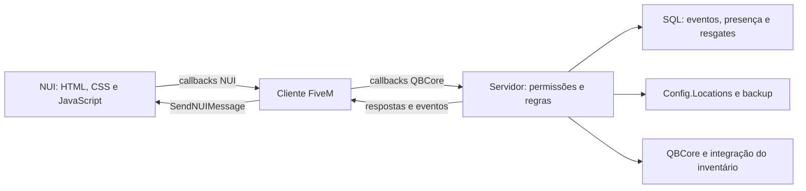

# Encontros-FiveM — funcionamento e revisão técnica

Revisão realizada em **24/10/2026**, sobre os arquivos atuais deste workspace.
O manifest declara a versão **3.0.0** do recurso; a política de recompensas está
na versão **2**. Esta revisão acrescenta documentação. Os achados abaixo ainda
precisam de correção no código ou de ajuste nas dependências instaladas.

## 1. Visão geral

O recurso administra encontros, resenhas e marcadores no FiveM com QBCore.
Permite criar eventos imediatos ou agendados, repetir eventos diariamente,
sortear locais, acompanhar presença pelo servidor e gerar prêmios individuais.

Existem três áreas administrativas:

| Aba | Função |
| --- | --- |
| Eventos | Consultar eventos, encerrar os ativos, cancelar e recriar eventos encerrados por bloqueio, cancelamento ou interrupção. |
| Criar encontro | Definir tipo, local, coordenadas, duração, agendamento, recorrência, blip e premiação. |
| Locais aleatórios | Cadastrar, editar e remover os pontos que alimentam o sorteio de locais. |

O tipo do evento e a categoria do prêmio são escolhas diferentes:

| Tipo | Comportamento |
| --- | --- |
| `encontro` | Evento com área de presença; pode ter premiação. |
| `resenha` | Tipo próprio com blip configurado; usa as mesmas regras globais de presença e recompensa. |
| `marcador` | Ponto informativo; a criação desativa a premiação e usa raio zero. |

| Categoria de premiação | Regra atual |
| --- | --- |
| `pecas_carro` | Uma unidade, sorteada uniformemente entre 26 itens permitidos. |
| `pecas_moto` | Uma unidade, sorteada uniformemente entre outros 26 itens. |
| `dinheiro` | Valor fixo em espécie, por jogador elegível, definido pelo admin. |
| `pecas_caminhao` | Bloqueada. |

## 2. Organização dos arquivos

| Arquivo ou pasta | Responsabilidade |
| --- | --- |
| [fxmanifest.lua](../fxmanifest.lua) | Dependências, ordem de carregamento e arquivos da NUI. |
| [config.lua](../config.lua) | Permissões, comandos, veículo exigido, NPCs, blips, tema, limites de dinheiro e locais. |
| [shared/reward_policy.lua](../shared/reward_policy.lua) | Catálogos fixos, validação dos itens, sorteio, limites monetários, percentual e prazo de resgate. |
| [server/attendance.lua](../server/attendance.lua) | Acúmulo de segundos a partir de observações consecutivas da mesma sessão. |
| [server/schema.lua](../server/schema.lua) | Criação e atualização do esquema SQL na inicialização. |
| [server/locations.lua](../server/locations.lua) | Validação, edição do trecho `Config.Locations`, backup e revisão da lista. |
| [server/main.lua](../server/main.lua) | Ciclo dos eventos, presença, persistência, permissões, callbacks, prêmios e recorrência. |
| [client/main.lua](../client/main.lua) | Blips, NPCs locais, `qb-target`, posicionamento do mecânico, foco da NUI, avisos e comunicação com o servidor. |
| [nui/ui.html](../nui/ui.html) | Estrutura dos painéis e formulários. |
| [nui/app.js](../nui/app.js) | Estado da interface, validação inicial, renderização e chamadas NUI. |
| [nui/style.css](../nui/style.css) | Aparência e adaptação da interface a diferentes tamanhos. |
| [nui/dev.html](../nui/dev.html) | Prévia com dados fictícios, fora do manifest de produção. |
| [setup.sql](../setup.sql) | Esquema para instalação nova; não substitui as migrações do servidor. |
| [tests/](../tests/) | Testes de Lua com Fengari e testes de interface com Node.js. |

A separação entre servidor, cliente, interface e política de recompensa é
adequada. A maior concentração de responsabilidades está em `server/main.lua`
com 970 linhas, `client/main.lua` com 733 e `nui/app.js` com 1.148, nesta revisão.
O tamanho é um sinal para organizar a manutenção, não uma falha por si só.



## 3. Dependências e inicialização

O manifest declara `qb-core`, `qb-inventory`, `qb-target` e `oxmysql`.
A disponibilidade desses recursos, isoladamente, não confirma a compatibilidade
das APIs utilizadas pelo Encontros. A integração de prêmios tem pendências
concretas nesta instalação, descritas no item M01.

Na inicialização, o servidor:

1. Obtém o objeto do QBCore e mantém o sistema como indisponível.
2. Lê a estrutura de `Config.Locations` para preparar a edição pelo painel.
3. Executa as instruções de `EncounterSchema`, em sequência, aguardando o SQL.
4. Migra registros de políticas anteriores à versão atual.
5. Habilita o sistema e recupera eventos ativos ou agendados do banco.

Se essa sequência falhar, `Ready` volta a `false`. Não existe uma recuperação
completa automática da inicialização; é necessário diagnosticar a causa e
reiniciar o recurso. A mensagem atual do console não mostra a exceção original.

A migração legada merece atenção: prêmios pendentes de políticas antigas e de
categorias permitidas podem ser sorteados novamente, com um novo prazo de 24
horas; categorias antigas incompatíveis são suspensas. Eventos antigos ativos
podem ser cancelados. Isso se aplica aos registros anteriores à política atual,
não a todo reinício.

## 4. Operação dos eventos

Os comandos padrão são `/encontrosadmin` e `/encontro`. Os grupos autorizados a
administrar são `admin` e `god`, conforme `Config.AdminGroups`. As operações de
escrita verificam a permissão no servidor.

### Criação e agendamento

O admin informa nome, tipo, blip, local, centro, raio, altura e duração. Para
premiações, também escolhe a categoria e define a posição do NPC de retirada.
No modo aleatório, o servidor escolhe centro, NPC e limites de área a partir
dos locais configurados.

O posicionamento do mecânico usa uma prévia local: setas para mover, `+` e `−`
para altura, scroll para direção, Enter para confirmar e Esc para cancelar.
A gravação do evento recebe as coordenadas confirmadas e as valida no servidor.

O horário agendado é digitado como data brasileira e hora de 24 horas na NUI.
O JavaScript o converte, usando o horário local do computador do admin, para Unix
timestamp. A duração aceita no servidor vai de 1 a 10.080 minutos.

Cada evento guarda o `routing_bucket` do admin na criação. Presença e retirada
local verificam a instância correspondente. A divulgação de eventos e os blips
não possuem a mesma filtragem por instância.

### Estados e encerramento

| Estado | Significado |
| --- | --- |
| `scheduled` | Criado, aguardando o horário de início. |
| `active` | Ativado e acompanhado pelo servidor. |
| `finished` | Encerrado normalmente, com avaliação de elegibilidade. |
| `cancelled` | Cancelado, sem gerar novos prêmios nessa ação. |
| `interrupted` | Encerramento ou ativação não puderam ser comprovados com segurança. |
| `blocked` | Uma regra ou configuração, como catálogo ou valor, impediu a continuidade. |

O término previsto usa `start_time + duration × 60`. O início efetivo é salvo
separadamente em `started_at`. Se um evento agendado começar atrasado, seu prazo
final continua sendo o originalmente planejado; a duração real acompanhada fica
menor. O encerramento administrativo também pode abreviar a duração.

No fechamento normal, o código prepara presença e prêmios, depois usa uma
transação para registrar término, totais de presença, resgates e próxima
recorrência. Um token de fechamento e índices únicos ajudam a evitar duplicação.
O resultado preparado fica em memória para permitir certas tentativas após
falha de persistência sem realizar outro sorteio.

### Recorrência e reinício

A recorrência é criada ao encerrar o evento. O próximo horário avança em blocos
de 86.400 segundos a partir do início planejado, pulando horários já vencidos.
Eventos aleatórios tentam evitar a chave do local anterior quando há alternativas.
Cancelamento administrativo interrompe a cadeia; certos encerramentos por
interrupção permitem criar a próxima ocorrência.

Ao reiniciar, os segundos de presença já persistidos são recuperados, mas o
intervalo sem observação não é creditado. Se o recurso esteve indisponível no
encerramento, o evento pode ser marcado como interrompido, sem novos prêmios.
Existe uma exceção de comportamento quando a lista aleatória fica vazia: a
recorrência reutiliza o local anterior; veja M06.

## 5. Presença e elegibilidade

A referência de tempo e posição vem do servidor. O cliente não envia um total
de presença aceito como prova. A coleta ocorre, nominalmente, a cada 5 segundos.

Um intervalo só é somado se houver duas observações consecutivas da mesma sessão
e o intervalo entre elas for positivo e de até 7 segundos. A primeira observação
abre a contagem. Uma ausência observada, desconexão ou troca de sessão interrompe
a continuidade, preservando os segundos já acumulados.

A área considera distância horizontal até o centro, tolerância vertical e
`routing_bucket`. Com a configuração atual, também é necessário chegar em um
**automóvel próprio**, validado por placa e `citizenid` em `player_vehicles`.

Depois de validar a chegada, o jogador pode estacionar e permanecer a pé dentro
da área. Sair da área ou perder a sessão elimina essa validação de chegada.
`driverOnly = false` permite validar o proprietário mesmo como passageiro.

Essa regra de veículo é global: também vale para **Resenha**, premiação em
dinheiro e categoria de peças de moto. Atualmente não existe uma regra de
veículo específica por tipo de evento ou categoria do prêmio.

O mínimo de presença é:

```text
max(1 segundo, arredondar para cima(60% × duração real acompanhada))
```

Exemplo: um evento encerrado após 20 minutos exige 12 minutos acumulados e
presença na avaliação final. Há limitações na forma como essa avaliação representa
o instante exato do encerramento; as reproduções estão em M02.

## 6. Premiações e retirada

### Peças de performance

O servidor escolhe o item no encerramento e grava o resultado. Não sorteia outra
peça a cada tentativa de retirada. O catálogo autoritativo vem de
`shared/reward_policy.lua`, não de um item arbitrário enviado pela NUI.

O resgate depende de `CommitEncounterReward` e `ReconcileEncounterReward`, além
de uma rotina de recuperação que consulta `GetPendingExternalItemMutations`.
Esses exports deveriam pertencer ao `qb-inventory`, mas **não foram encontrados
na cópia local inspecionada**. A função `Policy.itemInfo` descreve metadados de
performance, porém o contrato de entrega também precisa garantir sua aplicação.

### Dinheiro

`Config.MoneyReward` define mínimo, máximo e sugestão inicial. Os valores atuais
são 1, 1.000.000 e 1.000, respectivamente. O admin define um inteiro por jogador
elegível; não é um pote dividido entre os participantes.

O valor fica salvo no evento e é copiado para o resgate. Na retirada, o servidor
reserva o resgate com status `paying`, revalida personagem, posição e prazo,
credita `cash` com `Player.Functions.AddMoney`, solicita `Save()` e marca o resgate
como entregue. A operação utiliza o identificador `encontros-reward-<id>` no motivo.

A reserva evita a repetição automática de um pagamento incerto. Entretanto,
**o saldo persistido e o resgate ainda não são confirmados em uma única operação**;
há um risco adicional mesmo quando o resgate chega a `claimed`, detalhado em M03.

### Local e prazo

Por padrão, o NPC local é usado nos primeiros 600 segundos após o término.
Depois, o resgate passa ao NPC fixo. O prazo total é de 86.400 segundos a partir
do fechamento/sorteio, sem renovação na troca de NPC. O servidor exige proximidade
de até 3 metros e a instância apropriada. O `qb-target` usa a distância de interação
configurada no cliente, normalmente 2 metros.

| Estado de resgate | Tratamento |
| --- | --- |
| `pending` | Pode ser retirado enquanto o prazo estiver válido. |
| `paying` | Pagamento reservado ou incerto; requer análise se permanecer nesse estado. |
| `claimed` | Registrado como entregue. |
| `suspended` | Suspenso, por exemplo por incompatibilidade de política antiga. |
| `expired` | Calculado na consulta/interface para pendentes vencidos; não há rotina que necessariamente atualize essa coluna no banco. |

## 7. Locais aleatórios e gravação do config

A lista tem `key`, `label`, `coords = vector3(...)`, `npc = vector4(...)`,
`radius` e `heightTolerance`. A chave identifica o ponto e deve ser única.
Coordenadas novas/editadas são gravadas com duas casas decimais e raio/altura
com uma casa. As entradas que não foram editadas mantêm seu texto original.

Para salvar pelo painel, o servidor:

1. Verifica permissão administrativa e revisão da lista.
2. Confere se o trecho no disco continua igual ao carregado.
3. Valida os campos e rejeita chave duplicada.
4. Localiza o bloco e a entrada por uma análise dos tokens Lua.
5. Gera somente a substituição necessária, preservando o restante do arquivo.
6. Compila o candidato para verificar sintaxe, sem executar o código submetido.
7. Grava e verifica `config.lua.locations.bak` com o conteúdo anterior.
8. Grava `config.lua`, compara a leitura e tenta restaurar o anterior em caso de divergência.
9. Atualiza `Config.Locations` em memória e envia a nova revisão aos admins conectados.

Eventos já criados mantêm sua própria cópia do local. Os próximos sorteios usam
a lista atualizada. Uma edição manual dentro do bloco exige reiniciar o recurso
antes de continuar a edição pelo painel. Mudanças manuais fora do bloco são
preservadas na próxima gravação, mas suas outras configurações só entram em uso
quando forem recarregadas.

O editor espera uma lista literal no formato usado pelo projeto. Ele rejeita
listas calculadas por função e outros formatos que não consegue editar com
segurança. Comentários fora de uma entrada editada são preservados; comentários
e campos adicionais **dentro da entrada substituída** não têm preservação garantida.

## 8. Persistência e testes

| Tabela SQL | Conteúdo principal |
| --- | --- |
| `encontros` | Configuração e estado dos eventos, horários, NPC, instância, recorrência e dinheiro. |
| `encontros_attendance` | Total de segundos por evento e `citizenid`; atualizações usam totais absolutos com `GREATEST`. |
| `encontros_reward_claims` | Prêmio individual, personagem, quantidade/valor, prazo e situação da entrega. |

Os índices únicos de evento/personagem e de pai da recorrência ajudam a impedir
duplicação. Não existe rotina de retenção ou arquivamento do histórico.

Validação realizada nesta revisão:

| Verificação | Resultado e limite |
| --- | --- |
| Suíte local principal | **37 testes passaram**; inclui os scripts Lua reais com natives, SQL e integrações simulados. |
| Teste `catalog.test.cjs` | Não concluiu: falta `[jvscripts]/jv-retifica/config.lua`. |
| Catálogo contra o `qb-core/shared/items.lua` local | **0 dos 52 itens encontrados** com os nomes esperados pela política; não foi inspecionado o registro vivo após possíveis adições dinâmicas por outros recursos. |
| Exports exigidos do inventário | Os três nomes citados em M01 não aparecem nos fontes/manifest do `qb-inventory` local. |
| Simulações adicionais de revisão | Reproduziram os comportamentos de M02, M05, M06 e M11. |
| FiveM, banco e carga reais | Não executados nesta revisão. Não há medição de desempenho em produção. |

Com Node.js e `fengari` disponíveis, a suíte principal é:

```sh
node --test tests/locations.test.cjs tests/policy.test.cjs tests/server.test.cjs tests/ui.test.cjs tests/client_npc.test.cjs tests/client_notice.test.cjs
```

Não há `package.json` e lockfile neste recurso. Nesta máquina a execução usou o
Node embutido no VS Code e uma instalação já existente de Fengari em diretório
temporário; isso precisa ser tornado reproduzível para outras máquinas e CI.

## 9. Pontos de melhoria, em ordem de prioridade

**Alta**: pode impedir entrega ou violar regras centrais. **Média**: melhora
recuperação, consistência ou operação em crescimento. **Baixa**: clareza e manutenção.
“Reproduzido” significa simulação local com os handlers reais, não ocorrência
observada em um servidor de produção.

### M01 — Alta: completar a integração real de peças

**Evidência:** `server/main.lua`, rotinas de recuperação e `claimReward`, chamam
`GetPendingExternalItemMutations`, `ReconcileEncounterReward` e
`CommitEncounterReward`. Nenhum desses exports foi encontrado no inventário
local, cujo manifest declara versão 2.2.3. Os 52 itens da política também estão
ausentes do arquivo local `qb-core/shared/items.lua`. A revisão não verificou
possíveis cadastros dinâmicos no servidor em execução.

**Impacto:** sem o cadastro desses itens em runtime, a validação bloqueia a criação de eventos premiados com essas peças.
Mesmo que os itens sejam cadastrados, a retirada ainda depende dos exports
ausentes. O laço de recuperação esconde a exceção em um `pcall`.

**Melhoria:** implementar e testar um adaptador de entrega durável compatível com
o inventário instalado, cadastrar/validar os itens e seus metadados e verificar
essas capacidades na inicialização. A verificação deve distinguir funcionalidades
disponíveis, evitando anunciar peças como operacionais quando a integração falhar.
Trocar diretamente por `AddItem` sem tratar persistência e repetição não resolve
a garantia de entrega.

### M02 — Alta: tornar o fechamento independente de consultas durante a coleta

**Evidência:** `prepareClosure` chama `observe` → `presentPlayers` →
`insideEvent` → `vehicleOwnedBy`, que pode executar `MySQL.single.await`.
Essa preparação acontece antes de entrar em `lockedEvent` e antes de publicar
`PendingClosures`.

Foram reproduzidos três cenários:

| Cenário | Resultado atual |
| --- | --- |
| Jogador acumula 45 segundos, sai antes do fim de um evento de 60 segundos e retorna somente cinco segundos após o prazo; fechamento roda nesse momento. | Recebe um resgate, pois a tolerância de sete segundos usa a posição atual. |
| No fechamento, a consulta de propriedade do veículo de um jogador demora; outro participante retorna à área durante essa espera. | O segundo pode ser premiado apesar de estar ausente no disparo inicial. |
| A consulta de propriedade lança uma exceção no timer de encerramento; o banco volta a funcionar depois. | O evento permanece `active`; o amostrador posterior ignora eventos cujo prazo já passou e não retoma esse fechamento. |

**Impacto:** presença final pode divergir do instante exigido, e uma falha breve
pode deixar o evento preso como ativo. A consulta também permite intercalar
outras operações antes de existir uma preparação de fechamento protegida.

**Melhoria:** capturar posição, sessão e instância de todos os participantes sem
esperas; resolver a elegibilidade de veículo antes desse trecho; proteger e
reconciliar também as falhas da preparação. Definir explicitamente a tolerância
admitida no encerramento. Adicionar esses cenários à suíte permanente.

### M03 — Alta: confirmar a persistência do dinheiro antes de concluir o resgate

**Evidência:** `deliverMoney` chama `AddMoney`, depois `Save()`, e confirma a linha
de resgate. Na implementação local de `qb-core/server/player.lua`,
`QBCore.Player.Save` dispara `MySQL.insert(...)` sem aguardar uma confirmação de
sucesso para o chamador.

**Impacto:** além de pagamentos que ficam em `paying`, existe a possibilidade de
o resgate chegar a `claimed` e a gravação do saldo falhar ou não sobreviver a uma
queda. Nesse caso, o prêmio pode não estar no saldo salvo e não fica disponível
para nova retirada. O bloqueio contra repetição não garante que ambos os dados
tenham sido persistidos. Esse risco foi identificado no código, sem provocar
falha no banco real.

**Melhoria:** criar um identificador de pagamento persistente, com reconciliação
que coordene saldo online, salvamento e registro de resgate. Acrescentar uma
consulta administrativa de pagamentos pendentes/inconsistentes e testes de
falha no salvamento do jogador. Não liberar `paying` automaticamente sem evidência
do que já foi creditado.

### M04 — Média: reforçar a recuperação da gravação de config.lua

**Evidência:** `Locations.save` grava diretamente no arquivo de configuração e
confere a leitura depois. A cópia anterior é verificada, mas a tentativa de
restauração após falha não tem sua leitura final verificada.

**Impacto:** backup e verificação cobrem falhas comuns, mas uma queda durante a
escrita ainda pode deixar o Lua incompleto e impedir a inicialização. Há uma
única versão de backup, substituída a cada alteração. Comentários internos de
uma entrada editada são substituídos junto com a entrada.

**Melhoria:** manter a sincronização com `Config.Locations`, reforçando o protocolo
com escrita temporária e substituição atômica, se suportada e validada no runtime,
ou um diário de recuperação. Verificar a restauração, distinguir falha de rollback
e registrar autor, horário e alteração. Documentar ou preservar os comentários
internos de entradas editadas.

### M05 — Média: preservar as condições de eventos já aprovados

**Evidência reproduzida:** um evento em dinheiro de 1.000 foi criado com limite
permitido; após reiniciar com máximo de 500, ele retomou como ativo, mas terminou
`blocked`, sem prêmio. `prepareClosure` revalida o valor com os limites atuais;
a ativação/recuperação não realiza essa mesma checagem monetária.

**Melhoria:** definir se limites novos valem apenas para novas criações. Salvar a
política aplicável ao evento ou validar e informar a incompatibilidade antes de
retomar a participação. A mesma decisão deve ficar clara para regras globais de
veículo e versões futuras da política.

### M06 — Média: definir o que acontece com recorrências sem locais disponíveis

**Evidência reproduzida:** após criar um evento recorrente aleatório e esvaziar
`Config.Locations`, a próxima ocorrência reutilizou o local anterior. A função
`recurrenceQuery` passa para a cópia do evento quando não encontra outro local.

**Impacto:** um ponto removido do cadastro pode voltar a ser usado, embora uma
criação aleatória nova seja bloqueada quando a lista está vazia.

**Melhoria:** bloquear ou suspender a recorrência e avisar o admin, ou tornar essa
reutilização uma escolha explícita. Evitar a diferença silenciosa entre criação
manual e repetição automática.

### M07 — Média: reduzir trabalho repetido no banco e na rede

`attendanceQueries` persiste todos os registros acumulados de um evento a cada
ciclo, inclusive totais de jogadores ausentes que não mudaram. Em um exemplo
hipotético de três eventos com 200 registros cada, isso representa 120 upserts
por segundo, antes das demais consultas. É uma estimativa do fluxo, não um benchmark.

Cada cliente consulta NPCs periodicamente. No fechamento, os eventos `finished`,
`removed` e `refreshClaimNpcs` podem disparar três novas consultas por cliente.
Além disso, o painel público consulta presença a cada cinco segundos, embora os
cartões atuais não exibam os detalhes retornados.

**Melhoria:** manter totais alterados para persistência, usar lotes, consolidar a
notificação de NPCs e avaliar cache por instância. Remover a consulta visual de
presença se ela não tiver uso, preservando o amostrador autoritativo do servidor.
Medir consultas, duração de ciclos e atraso do fechamento antes de otimizar mais.

### M08 — Média: fortalecer testes de integração e o ambiente de desenvolvimento

Os testes usam SQL em memória e stubs que já oferecem as APIs esperadas de
inventário. Isso explica por que 37 testes passam com a instalação real ainda
incompleta. Eles não verificam sintaxe SQL contra o banco real, durabilidade do
saldo nem comportamento dos natives no FiveM.

**Melhoria:** adicionar `package.json`, versões fixas e scripts de teste; permitir
configurar os caminhos do catálogo externo; testar o contrato com as dependências
instaladas e com a engine SQL utilizada. Incorporar os casos de M02, M05 e M06,
além de quedas no meio de gravações. Uma etapa em servidor de teste deve verificar
resgate, reinício, troca de instância e restauração do config.

### M09 — Média: melhorar diagnóstico, auditoria e proteção das operações

As mensagens genéricas de `pcall` descartam o erro original de diversas rotinas,
e a recuperação de inventário pode falhar sem mensagem. Não há trilha persistente
própria de alterações administrativas de eventos/locais, nem limites explícitos
por jogador para os callbacks de consulta que atingem o banco.

**Melhoria:** registrar operação, erro original, evento/resgate e identificador
de correlação; auditar alterações de admin; aplicar limites de frequência aos
endpoints caros. Acrescentar um diagnóstico que informe dependências, estado
`Ready`, eventos vencidos ainda ativos e pagamentos em verificação.

### M10 — Média: organizar módulos, consultas e migrações

`server/main.lua` combina autorização, persistência, presença, agendamento,
recorrência, migração, prêmios e entrega. Cliente e JavaScript também concentram
vários fluxos independentes. O estado compartilhado torna alterações cruzadas
mais difíceis de revisar.

**Melhoria:** extrair repositório SQL, serviço de eventos, serviço de presença,
entrega de dinheiro/itens e callbacks, preservando as mesmas travas. Separar a
NUI por eventos, locais e resgates. Consolidar validações que hoje se repetem.
Versionar migrações para evitar repetir toda a sequência de DDL em cada início;
validar sua sintaxe na engine usada. Planejar retenção/paginação do histórico e
avaliar índices das consultas com `EXPLAIN`, sem adicioná-los sem medição.

### M11 — Baixa: corrigir inconsistências visuais e atualizar a prévia

**Evidência reproduzida:** `getTypeLabel('resenha')` retorna `Encontro`, pois
`nui/app.js` só trata explicitamente `marcador` e o tipo antigo `carros`.
Isso afeta o selo na listagem administrativa, embora o tipo salvo seja `resenha`.

A prévia `nui/dev.html` não inclui as novas categorias e respostas de locais.
Textos de prazo usam valores fixos de dez minutos/24 horas, mesmo existindo
parâmetros de política, e a folha de ícones depende de um CDN externo.

**Melhoria:** incluir o rótulo Resenha, atualizar as demonstrações, derivar textos
dos mesmos parâmetros usados no servidor e empacotar os ícones utilizados.
Definir explicitamente se horários devem ser locais ao jogador ou ao servidor.

### M12 — Média: explicitar regras por categoria e por instância

A configuração atual só permite `automobile` próprio para qualquer evento;
uma Resenha e um encontro premiado com peças de moto também seguem essa regra.
Os eventos são divulgados globalmente, mas a presença e o resgate local exigem
o bucket correto.

**Melhoria:** decidir regras de participação por tipo de evento/categoria e
documentá-las no painel. Se houver eventos restritos a instâncias, filtrar também
consulta pública, avisos e blips, ou deixar claro como acessar a instância.
São decisões de produto a implementar; não se deve presumir que Resenha dispensa
veículo na versão atual.

## 10. Ordem sugerida de trabalho

1. Resolver M01 e garantir que a inicialização exponha quais prêmios estão operacionais.
2. Corrigir M02 e M03 com testes de falha, preservando a regra de 60% e as garantias contra duplicidade.
3. Ajustar M04, M05 e M06 para que falhas e mudanças de configuração tenham comportamento previsível.
4. Tornar o ambiente de testes reproduzível, acrescentar diagnóstico e medir o custo das consultas.
5. Fazer a divisão dos módulos em alterações pequenas, seguida dos ajustes de interface e regras específicas.

Essa ordem prioriza a entrega correta e a presença no encerramento antes de
refatorações amplas ou mudanças apenas visuais.
